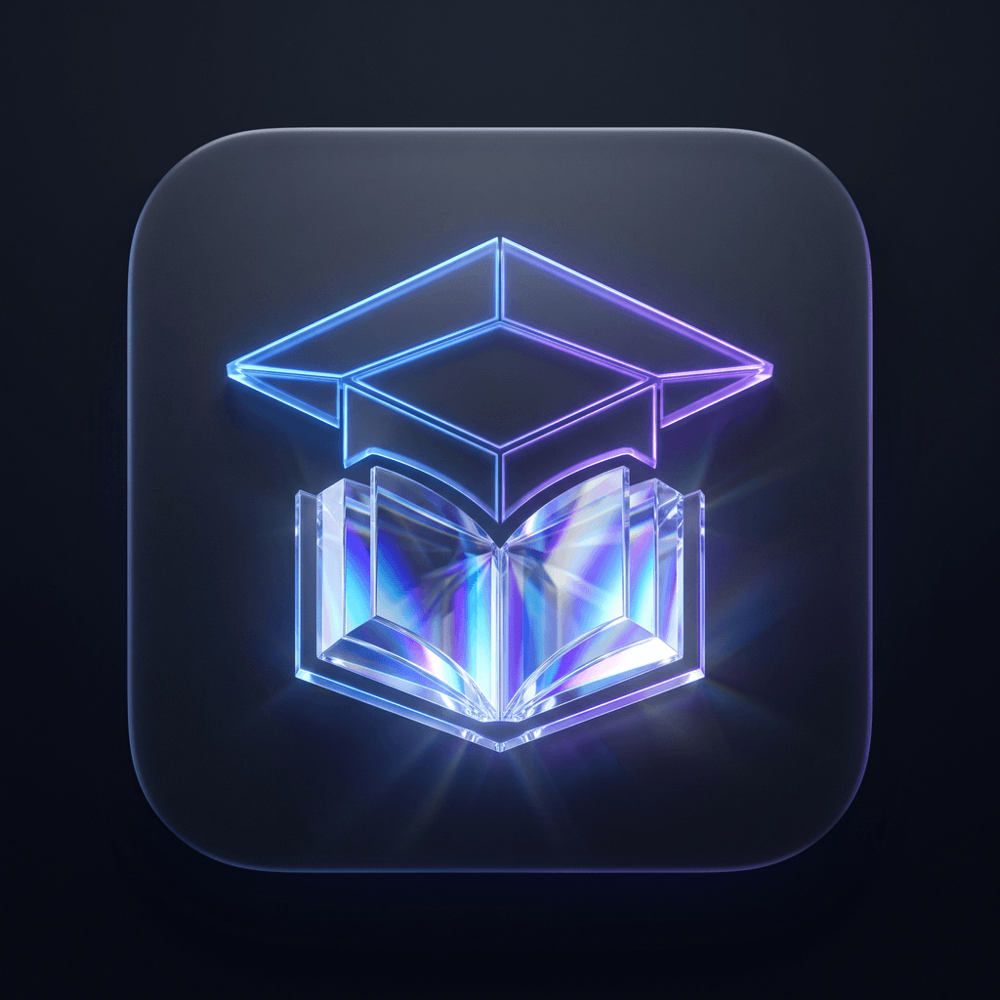
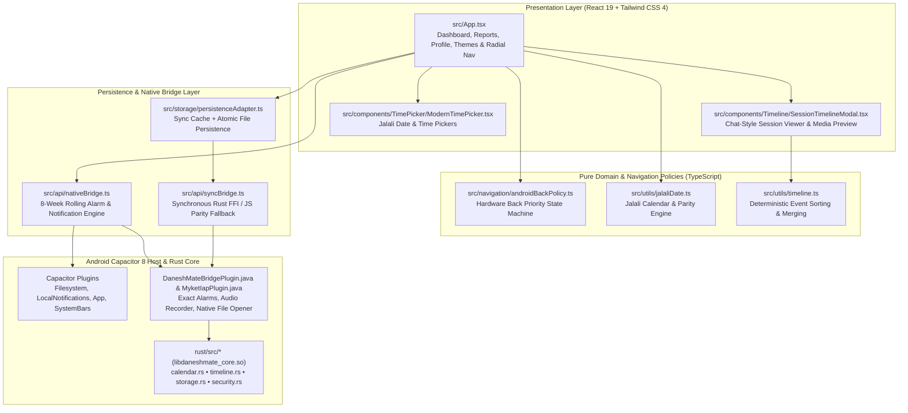

<div align="center">



# DaneshMate (دانش‌میت)

### Offline-First Smart University Companion, Jalali Class Scheduler & Multimodal Session Logger for Android

DaneshMate is a privacy-first, offline-capable academic productivity application engineered specifically for university students operating on the **Persian (Jalali / Solar Hijri) calendar**. Built with **React 19**, **TypeScript**, **Capacitor 8**, and a **Rust Native Core**, it unifies weekly and biweekly class schedules, multimodal in-class session capture (voice, slides, PDFs, notes), and deterministic native Android notifications in a fast, zero-cloud-dependency mobile workspace.

[](#release--distribution)
[](#android--capacitor-development)
[](#tech-stack)
[](#architecture-overview)

<br />

### **Download DaneshMate on Myket**
**[دانلود دانش‌میت از مایکت](https://myket.ir/app/com.daneshmate.app)**  
[`https://myket.ir/app/com.daneshmate.app`](https://myket.ir/app/com.daneshmate.app)

</div>

---

## Table of Contents

1. [Why DaneshMate Exists](#1-why-daneshmate-exists)
2. [Key Features](#2-key-features)
3. [معرفی کوتاه فارسی (Persian Summary & Download)](#3-معرفی-کوتاه-فارسی-persian-summary--download)
4. [Screenshots & Visual Preview](#4-screenshots--visual-preview)
5. [Architecture Overview](#5-architecture-overview)
6. [Tech Stack](#6-tech-stack)
7. [Repository Structure](#7-repository-structure)
8. [Getting Started (Web Development)](#8-getting-started-web-development)
9. [Android / Capacitor Development](#9-android--capacitor-development)
10. [Rust Core Development (JNI Bridge & Web Fallback)](#10-rust-core-development-jni-bridge--web-fallback)
11. [Available Scripts & Verification Suite](#11-available-scripts--verification-suite)
12. [Data Privacy & Offline-First Principles](#12-data-privacy--offline-first-principles)
13. [Release & Distribution](#13-release--distribution)
14. [Roadmap](#14-roadmap)
15. [Contributing](#15-contributing)
16. [Security](#16-security)
17. [License & Author](#17-license--author)

---

## 1. Why DaneshMate Exists

University students in Iran and Persian-speaking academic environments face a recurring set of workflow friction points that generic calendar and note-taking apps fail to address:

- **Weekly vs. Biweekly Class Collisions:** University courses frequently alternate on odd/even weeks (`یک هفته درمیان`) sharing the same weekday and time slot. Standard timetable apps either lack native Jalali biweekly parity tracking or falsely flag alternating classes on opposite weeks as scheduling conflicts.
- **Fragmented Lecture Artifacts:** During a single lecture, a student records voice explanations, photographs whiteboard formulas, downloads PDF slides, and writes quick follow-up reminders. In typical workflows, these end up scattered across voice recorders, camera rolls, and messaging app "Saved Messages."
- **Missed Recurring Reminders:** Mobile OS battery optimizations and single-shot local notifications often cause recurring class alerts to silently expire if a student does not open the app for several days.
- **Unreliable Campus Connectivity:** Lecture halls and basements frequently have weak or restricted internet access. An academic tool must launch instantaneously and function 100% offline without mandatory cloud accounts.

**DaneshMate** solves these problems by combining a **Jalali-native recurrence & conflict engine**, a **chat-style multimodal session timeline**, and a **rolling-window native Android alarm scheduler** inside an ergonomic, RTL-first interface.

---

## 2. Key Features

### 📅 Smart Jalali Class & Schedule Management
- **Native Solar Hijri (Jalali) Calendar Engine:** Full support for Iranian academic weekdays (`شنبه` through `پنج‌شنبه`), leap-year-accurate Jalali date conversion, and Persian numerals.
- **Parity-Aware Recurrence & Conflict Detection:** Supports weekly (`هر هفته`), biweekly (`یک هفته درمیان`), and one-time (`تک‌جلسه`) classes. Biweekly schedules are anchored to a Jalali reference date (`referenceDateText`) so two biweekly classes sharing the same day and time slot on opposite weeks coexist without false conflict errors.
- **Live Class Status Indicator:** Automatically highlights whether a class is currently in progress, upcoming today, or scheduled later in the week.

### 🎙️ Multimodal Session Capture & Chat-Style Timeline Review
- **In-Class Multimodal Logging:** Record lecture audio (or attach audio files), attach PDFs, PowerPoint decks, Word documents, and images, and write structured session notes linked directly to a specific course and session number.
- **Chronological Chat-Style Timeline (`SessionTimelineModal`):** Review every lecture session as an interactive, time-ordered stream of text notes, voice recordings (with variable playback speed `1x`, `1.5x`, `2x`), and file attachments.
- **In-App Media & Document Preview:** Preview attached images, audio streams, and document metadata directly inside the session viewer or open files natively on Android.
- **Session-Specific Reminders:** Configure quick relative reminders or exact Jalali date/time follow-up alerts for individual lecture sessions (e.g., homework deadlines or quiz dates).

### 🔔 Resilient Native Notification & Alarm Engine
- **8-Week Rolling Horizon Scheduler:** Schedules upcoming occurrences across an 8-week rolling window (`syncClassScheduleReminders`) so recurring class reminders continue firing reliably even if the student does not open the app for weeks.
- **Deterministic Notification IDs & Legacy Cleanup:** Prevents duplicate alerts and automatically cleans up outdated notification IDs whenever a class is edited or deleted.
- **Lifecycle Auto-Resync:** Automatically replenishes future reminder windows on cold start and whenever the Android app returns to the foreground (`appStateChange`).

### 🎨 Ergonomic RTL Interface & Android System Integration
- **Safe-Area-Aware Floating Radial Navigation:** Thumb-friendly bottom radial menu with elevated upward arc geometry (`22°` to `158°`), visual hierarchy separating primary academic views (`داشبورد`, `یادداشت‌ها`, `گزارشات`) from utility views (`پروفایل`, `تنظیمات پوسته`), and automatic adaptation to Android 3-button (`Back / Home / Recents`) and Gesture Navigation insets (`--safe-area-inset-bottom`).
- **Predictable Hardware Back Navigation Policy:** Pure, unit-tested state machine (`resolveAndroidBackAction`) that closes active file previews, time/date pickers, session timelines, the radial menu, or profile views in strict priority order before exiting the app.
- **12 Curated 2026 Visual Themes:** Includes Dark Cyber-Luxe (`Deep Space`, `Emerald Matrix`, `AMOLED Pitch`), Daylight (`Clean Daylight`, `Soft Academic`, `Warm Paper`, `Minimal Frost`), High-Contrast Accessibility, and Tactile Neumorphic palettes.

---

## 3. معرفی کوتاه فارسی (Persian Summary & Download)

<div dir="rtl">

**دانش‌میت (DaneshMate)** یک دستیار هوشمند، آفلاین‌محور و بومی برای دانشجویان است که بر پایه تقویم جلالی (شمسی) و نیازهای واقعی محیط دانشگاه طراحی شده است.

### قابلیت‌های کلیدی دانش‌میت:
- **مدیریت هوشمند برنامه کلاسی:** پشتیبانی دقیق از کلاس‌های «هر هفته»، «یک هفته درمیان» (با تشخیص زوج و فرد بودن هفته‌ها بدون خطای تداخل کاذب) و «تک‌جلسه».
- **ثبت چندرسانه‌ای جلسات درس:** امکان ضبط صدای استاد، پیوست جزوات (PDF، اسلاید، تصویر و فایل متنی) و ثبت یادداشت‌های تکمیلی برای هر جلسه در قالب یک تایم‌لاین تعاملی شبیه پیام‌رسان.
- **یادآورهای دقیق و پایدار اندروید:** زمان‌بندی هوشمند اعلان‌های کلاس در بازه ۸ هفته‌ای به همراه یادآورهای اختصاصی برای هر جلسه یا امتحان، حتی در صورت باز نکردن طولانی‌مدت برنامه.
- **طراحی ارگونومیک و هماهنگ با اندروید:** منوی شعاعی شناور سازگار با نوار ناوبری سه‌دکمه‌ای و ژست‌های حرکتی اندروید، مدیریت استاندارد دکمه Back، و ۱۲ پوسته متنوع (تاریک، روشن، کنتراست بالا و نئومورفیک).
- **کاملاً آفلاین و حافظ حریم خصوصی:** تمامی اطلاعات، فایل‌ها و یادداشت‌های شما بدون نیاز به ثبت‌نام یا سرور ابری، به‌صورت محلی و امن روی دستگاه ذخیره می‌شوند.

📥 **دریافت نسخه رسمی اندروید:**
- **[دانلود دانش‌میت از مایکت](https://myket.ir/app/com.daneshmate.app)**

</div>

---

## 4. Screenshots & Visual Preview

> **Note on Repository Assets:** The repository includes official application icons and splash assets under [`assets/`](./assets) (`assets/icon.png`, `assets/adaptive-icon.png`, `assets/splash.png`). Live production screenshots showcasing the Dashboard, Session Timeline Modal, Jalali Pickers, and 12 Theme Palettes can be viewed directly on the **[Official DaneshMate Myket Store Page](https://myket.ir/app/com.daneshmate.app)**.
>
> Contributors adding high-resolution device captures for GitHub documentation should place PNG/WebP screenshots in `assets/screenshots/` and reference them here.

---

## 5. Architecture Overview

DaneshMate uses a layered **Hybrid Native + Web** architecture with a clean separation between UI components, pure domain/navigation policies, dual-layer persistence, and optional Rust JNI acceleration:



### Core Architectural Highlights
1. **Zero-Latency Synchronous Hydration (`persistenceAdapter.ts`):** On startup, the app synchronously hydrates state from local snapshot cache for an instant first paint, then asynchronously reconciles with the atomic JSON database (`Directory.Data/daneshmate_atomic_v2_db.json`) via `@capacitor/filesystem`.
2. **Pure Testable Policies:** Critical logic—including Android hardware Back resolution (`androidBackPolicy.ts`), chronological timeline event merging (`timeline.ts`), and biweekly parity conflict detection (`jalaliDate.ts` / `nativeBridge.ts`)—is isolated in pure TypeScript modules verified by standalone automated test suites.
3. **Dual-Execution Rust / TypeScript Bridge (`syncBridge.ts`):** When running inside the Android native WebView with `window.DaneshMateRust` injected, calendar math, timeline validation, and atomic storage operations can route to `libdaneshmate_core.so` via JNI. In browser development or if native binaries are absent, `syncBridge.ts` transparently executes identical pure TypeScript fallback logic.

---

## 6. Tech Stack

| Layer | Technology | Version / Details |
| :--- | :--- | :--- |
| **UI Framework** | React + React DOM | `^19.2.4` |
| **Language** | TypeScript | `~5.8.2` (Strict typing) |
| **Bundler & Dev Server** | Vite + `@vitejs/plugin-react` | `^8.0.1` |
| **Styling** | Tailwind CSS v4 (`@tailwindcss/vite`) | `^4.2.2` + CSS Custom Properties for 12 Themes |
| **Icons** | Lucide React | `^1.16.0` |
| **Mobile Runtime** | Capacitor (`@capacitor/core`, `@capacitor/android`) | `^8.2.0` / `^8.3.0` (`compileSdk 36`, `minSdk 24`) |
| **Native Plugins** | `@capacitor/app`, `@capacitor/filesystem`, `@capacitor/local-notifications`, `@capacitor/share`, `@capawesome/capacitor-file-picker` | Official Capacitor 8 ecosystem + custom Java plugins |
| **Native Core (Optional/JNI)** | Rust (`daneshmate_core`) | Edition `2021` (`serde`, `serde_json`, `sha2`, `hmac`, `jni`) |
| **CI/CD & Distribution** | GitHub Actions | Automated Debug APK artifacts + Signed Production Release & Myket Publisher API CD |

---

## 7. Repository Structure

```text
.
├── .github/
│   └── workflows/
│       ├── capacitor-test.yml          # Automated Debug APK build (Rust NDK + Vite + Gradle)
│       └── release.yml                 # Production Signed APK, GitHub Release & Myket CD pipeline
├── android/                            # Capacitor 8 Android native project (compileSdk 36)
│   └── app/src/main/java/com/daneshmate/app/
│       ├── MainActivity.java           # Capacitor BridgeActivity & custom plugin registration
│       ├── DaneshMateBridgePlugin.java # Exact alarms, voice recorder, file opener & Rust JNI bridge
│       └── MyketIapPlugin.java         # Myket In-App Billing integration plugin
├── assets/                             # App icons, adaptive icons, and splash screen sources
├── rust/                               # Rust native core crate (daneshmate_core)
│   ├── Cargo.toml
│   └── src/
│       ├── lib.rs                      # Crate entry point
│       ├── calendar.rs                 # Jalali calendar & conflict detection in Rust
│       ├── timeline.rs                 # Session timeline validation & sorting
│       ├── storage.rs                  # Atomic storage & backup export/import
│       ├── security.rs                 # HMAC-SHA256 integrity verification
│       └── ffi.rs                      # C-ABI & Android JNI exports
├── scripts/                            # Direct automated verification & regression test suites
│   ├── run_android_back_policy_tests.ts
│   ├── run_reminder_scheduling_tests.ts
│   ├── run_timeline_extraction_tests.ts
│   ├── run_timeline_regression_tests.ts
│   └── verify_ffi.mjs
├── src/
│   ├── api/
│   │   ├── nativeBridge.ts             # Capacitor native APIs & 8-week rolling alarm scheduler
│   │   └── syncBridge.ts               # Synchronous Rust FFI bridge with JS parity fallback
│   ├── components/
│   │   ├── TimePicker/
│   │   │   └── ModernTimePicker.tsx    # Custom Jalali Time Picker modal
│   │   └── Timeline/
│   │       └── SessionTimelineModal.tsx# Extracted chat-style session timeline viewer
│   ├── navigation/
│   │   └── androidBackPolicy.ts        # Pure Android hardware Back priority resolver
│   ├── storage/
│   │   └── persistenceAdapter.ts       # Dual-layer localStorage + Capacitor Filesystem persistence
│   ├── types/
│   │   ├── index.ts                    # Shared domain types
│   │   └── sessionLog.ts               # Session timeline & attachment types
│   ├── utils/
│   │   ├── jalaliDate.ts               # Solar Hijri calendar conversions & parity math
│   │   └── timeline.ts                 # Chronological timeline event builder & sorter
│   ├── App.tsx                         # Main application shell, views, and radial navigation
│   ├── index.css                       # Global styles, safe-area variables, and glassmorphism utilities
│   └── main.tsx                        # React 19 root mount
├── capacitor.config.ts                 # Capacitor configuration (appId: com.daneshmate.app)
├── index.html                          # Entry HTML (viewport-fit=cover, RTL Persian metadata)
├── package.json                        # Scripts, dependencies, and project version (1.6.0)
├── tsconfig.json                       # TypeScript compiler configuration
└── vite.config.ts                      # Vite bundler configuration
```

---

## 8. Getting Started (Web Development)

DaneshMate runs out of the box in any modern desktop or mobile browser using its pure TypeScript/Web fallback layer.

### Prerequisites
- **Node.js:** `v20+` or `v22+` (LTS recommended)
- **npm:** `v10+`

### Installation & Local Dev Server

```bash
# 1. Clone the repository
git clone https://github.com/alireza81880/DaneshMate.git
cd DaneshMate

# 2. Install dependencies cleanly
npm ci

# 3. Start the Vite development server on port 3000
npm run dev
```

### Type-Check & Production Web Bundle

```bash
# Run strict TypeScript validation
npm run lint

# Build the production web bundle into dist/
npm run build

# Preview the production bundle locally
npm run preview
```

---

## 9. Android / Capacitor Development

To build and run the native Android application locally on an emulator or physical device:

### Prerequisites
- **Java Development Kit (JDK):** Version `21`
- **Android Studio & Android SDK:**
  - `compileSdkVersion = 36`
  - `targetSdkVersion = 36`
  - `minSdkVersion = 24`
- **Android NDK:** Required only if recompiling the Rust JNI libraries (`cargo-ndk`).

### Sync Web Assets & Build Debug APK

```bash
# Build web assets into dist/ and sync with the Android Capacitor project
npm run cap:sync

# Open the Android project in Android Studio
npm run android:open

# Or build a Debug APK directly from the command line
npm run android:build:debug
```

The resulting debug APK is generated at:
`android/app/build/outputs/apk/debug/app-debug.apk`

---

## 10. Rust Core Development (JNI Bridge & Web Fallback)

The `rust/` directory contains the `daneshmate_core` Rust library (`cdylib`, `staticlib`, `rlib`), which implements Jalali date arithmetic, recurrence conflict detection, timeline event sorting, atomic file persistence, and HMAC-SHA256 integrity checks.

- **Web & Dev Fallback:** During browser development (`npm run dev`), `src/api/syncBridge.ts` automatically detects that `window.DaneshMateRust` is not present and executes equivalent TypeScript implementations with zero configuration required.
- **Building Android JNI Binaries (`libdaneshmate_core.so`):**

```bash
# Install Android targets and cargo-ndk
rustup target add aarch64-linux-android armv7-linux-androideabi x86_64-linux-android
cargo install cargo-ndk

# Run Rust unit tests
cd rust && cargo test

# Cross-compile JNI shared libraries into android/app/src/main/jniLibs
cargo ndk \
  -t arm64-v8a \
  -t armeabi-v7a \
  -t x86_64 \
  -o ../android/app/src/main/jniLibs \
  build --release
```

---

## 11. Available Scripts & Verification Suite

All scripts defined in [`package.json`](./package.json) can be executed via `npm run <script>`:

| Script | Command | Purpose |
| :--- | :--- | :--- |
| `npm run dev` | `vite --port=3000 --host=0.0.0.0` | Launches the local development server |
| `npm run build` | `vite build` | Compiles production frontend assets to `dist/` |
| `npm run lint` | `tsc --noEmit` | Runs full TypeScript type checking without emitting files |
| `npm run test:back-policy` | `npx tsx scripts/run_android_back_policy_tests.ts` | Runs direct unit tests for Android Back navigation priorities (including Radial Menu & Profile flows) |
| `npm run test:reminder` | `npx tsx scripts/run_reminder_scheduling_tests.ts` | Verifies weekly/biweekly conflict detection, Jalali parity, and 8-week rolling notification windows |
| `npm run test:timeline` | `npx tsx scripts/run_timeline_regression_tests.ts` | Runs regression tests for session timeline state & persistence |
| `npm run test:timeline-utils` | `npx tsx scripts/run_timeline_extraction_tests.ts` | Verifies deterministic timestamp extraction & chronological timeline sorting |
| `npm run test:ffi` | `node scripts/verify_ffi.mjs` | Audits FFI / JNI contract alignment between TypeScript and Rust |
| `npm run cap:sync` | `npm run build && npx cap sync android` | Builds frontend and synchronizes assets/plugins with `android/` |
| `npm run android:build:debug` | `npm run cap:sync && cd android && ./gradlew assembleDebug` | Builds a complete installable Debug APK |

---

## 12. Data Privacy & Offline-First Principles

DaneshMate is designed around strict student data sovereignty:

1. **100% Local Storage:** All class schedules, student profile metadata, session text logs, voice recordings, and file attachments remain on the user's device (`localStorage` snapshot cache + `@capacitor/filesystem` `Directory.Data`).
2. **No Mandatory Accounts or Telemetry:** Students can use every core scheduling and note-taking feature immediately without creating an account, sharing an email/phone number, or connecting to external servers.
3. **Explicit Permissions:** Android runtime permissions (`POST_NOTIFICATIONS`, `SCHEDULE_EXACT_ALARM`, `RECORD_AUDIO`) are requested strictly for user-initiated class reminders and lecture voice recording.

---

## 13. Release & Distribution

DaneshMate uses automated GitHub Actions pipelines for both testing and production distribution:

- **Debug Testing Workflow (`.github/workflows/capacitor-test.yml`):** Compiles the Rust JNI targets, runs all TypeScript/domain verification suites, builds the Vite bundle, and produces an installable `app-debug.apk` artifact on push/PR or manual `workflow_dispatch`.
- **Production Release & Myket CD (`.github/workflows/release.yml`):** Triggered on `v*.*.*` tags or version updates on `main`. It validates version synchronization, runs all automated test suites, compiles the Rust NDK binaries, builds and signs the production release APK (`v1` + `v2` signatures), publishes a GitHub Release, and automatically uploads and submits the signed APK to the **Myket Developer Panel** via the Myket Publisher API.
- **Official Store Listing:** **[DaneshMate on Myket (`com.daneshmate.app`)](https://myket.ir/app/com.daneshmate.app)**

---

## 14. Roadmap

- [ ] **Encrypted Local Backup & Restore UI:** Expose one-tap JSON/Archive export and import in the Profile/Settings view for seamless device migration.
- [ ] **Home Screen Android Widgets:** Native glanceable today/weekly Jalali schedule widget.
- [ ] **PDF & Image Annotation:** Lightweight in-app highlighting for attached lecture slides.
- [ ] **Semester GPA & Exam Countdown Tracker:** Dedicated final exam schedule view alongside recurring weekly classes.

---

## 15. Contributing

Contributions, bug reports, and UX improvements are welcome! To keep the codebase reliable:

1. **Fork & Branch:** Create a focused feature or bugfix branch from `main`.
2. **Preserve Offline & RTL Invariants:** Ensure all UI additions support `dir="rtl"`, respect `--safe-area-inset-bottom`, and work across both dark and light theme families in `THEMES_2026`.
3. **Run the Verification Suite Before Opening a PR:**
   ```bash
   npm run lint
   npm run test:back-policy
   npm run test:reminder
   npm run test:timeline
   npm run test:timeline-utils
   npm run test:ffi
   npm run build
   ```
4. **Pull Request:** Open a pull request clearly describing the problem, root cause, and verification results.

---

## 16. Security

- **Secret Hygiene:** Never commit Android keystore files (`*.jks`, `*.keystore`), signing passwords, Myket API tokens, or `.env` files to the repository. All production signing and store credentials are injected exclusively via encrypted GitHub Actions Secrets.
- **Reporting Vulnerabilities:** If you discover a security or data-integrity issue, please report it responsibly via the maintainer's contact links on [alireza81880.github.io](https://alireza81880.github.io/) before disclosing it publicly.

---

## 17. License & Author

- **License Status:** No `LICENSE` file is currently present in the repository root. Under standard GitHub terms, source code without an explicit license file defaults to all rights reserved by the author until a `LICENSE` file (such as MIT or Apache-2.0) is added by the project maintainer.
- **Author & Maintainer:** Designed and engineered by **null** ([alireza81880.github.io](https://alireza81880.github.io/)).
- **Official Download:** **[Download DaneshMate on Myket (دانلود دانش‌میت از مایکت)](https://myket.ir/app/com.daneshmate.app)**
